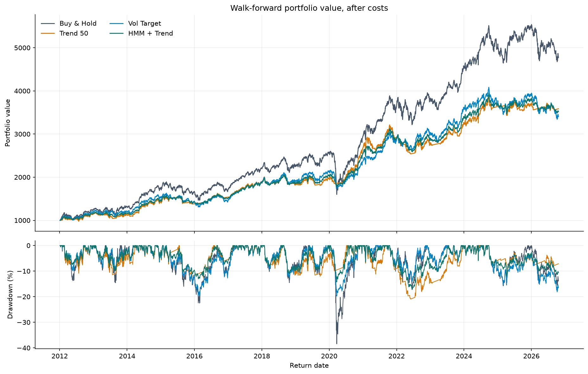
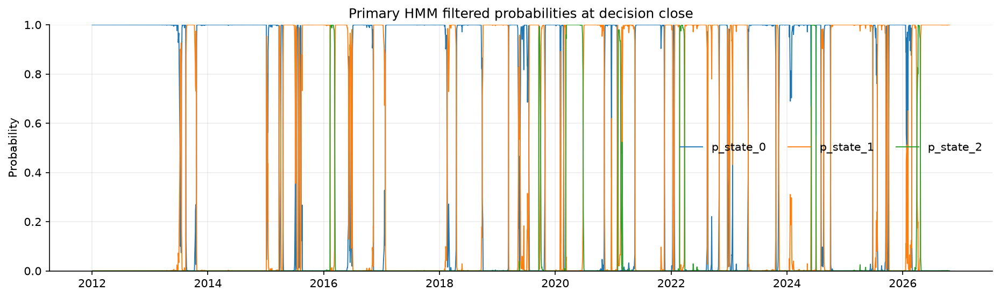

# Walk-forward regime backtest

Research only; not investment advice. This is a reconstruction, not an exact rerun of the unavailable earlier 14-model implementation.

## Data and setup

- Source: `csv`; path: `/tmp/mra-archive/market-regime-platform/data/raw/nifty_index.csv`; SHA-256: `ea6dfffb93e5eabd8b6a2f96cd40d6b3ec5c7f47f2f9e6c0cbd3ca9a5f2ac5e4`.
- Source URL, if provided: not recorded.
- Data used: 2007-09-17 to 2026-10-22 (4684 rows).
- OOS signal dates: 2012-01-03 to 2026-10-22; realized return dates: 2012-01-05 to 2026-10-22 (3632 observations).
- Expanding training window, annual refits, at least 504 feature-valid days; rolling maximum: None.
- Primary model: `rvd_3`; 4 pre-specified model(s); state ordering is by **training weighted next-day volatility**.
- Target vol: 12.0%; HMM/trend blend: 50%/50%.
- Cash earns 6.50% annualized; 10 bps per one-way traded notional; 252 trading days/year.
- **Execution:** An extra 1 session(s) elapse between decision close and execution close.

## Input quality

`data_quality.csv` lists yearly close-return volatility and, if Open is available, its coverage, OHLC out-of-range observations, overnight/intraday volatility and the fraction of opens essentially equal to the previous close. These checks flag investigation candidates; they do not certify data quality. Early Open quotes can be unreliable. The default models use Close only.

## Performance

| Strategy | CAGR | Volatility | Sharpe | Sortino | Max DD | Calmar | Exposure | Turnover/yr |
| --- | --- | --- | --- | --- | --- | --- | --- | --- |
| Buy & Hold | 11.45% | 16.06% | 0.36 | 0.50 | 38.44% | 0.30 | 100.0% | 0.07 |
| Trend 50 | 9.26% | 11.13% | 0.29 | 0.40 | 20.93% | 0.44 | 68.4% | 12.90 |
| Momentum 20 | 5.43% | 10.18% | -0.05 | -0.07 | 17.63% | 0.31 | 61.6% | 22.89 |
| MA Reversion | 7.34% | 10.84% | 0.13 | 0.17 | 34.71% | 0.21 | 22.6% | 9.85 |
| RSI Reversion | 6.16% | 10.03% | 0.02 | 0.03 | 32.67% | 0.19 | 18.8% | 6.93 |
| Donchian | 5.25% | 8.97% | -0.09 | -0.12 | 14.81% | 0.35 | 49.5% | 6.93 |
| Vol Target | 8.88% | 11.88% | 0.25 | 0.34 | 19.76% | 0.45 | 85.1% | 4.01 |
| HMM Ensemble | 8.83% | 10.84% | 0.25 | 0.35 | 21.01% | 0.42 | 75.4% | 1.77 |
| HMM + Trend | 9.12% | 10.33% | 0.29 | 0.40 | 17.20% | 0.53 | 71.9% | 7.35 |

Max DD is a positive magnitude; turnover is one-way traded notional divided by portfolio value, annualized. Fractional targets rebalance daily and their turnover includes weight drift. Initial entry costs are included; no artificial terminal liquidation. Sharpe uses daily excess returns over the cash rate; CAGR is annualized by trading observations. Index price returns omit dividends unless the input is a total-return series.

## H1 — descriptive regimes

Labels use the primary model's probability at each **decision close**; outcomes below are the market returns over the interval held after execution. Run lengths and occupancy describe the observed rank labels, not evidence that a distinct underlying economic regime exists. The effective number of occupied states is 2.12; the largest rank covers 56.0% of intervals. Ranks are recalibrated at every refit and can change meaning across years.

| Volatility rank | Days | Occupancy | Mean run | Held-interval mean | Held-interval vol/yr |
| --- | --- | --- | --- | --- | --- |
| 0 | 2035 | 56.0% | 59.9 | 0.032% | 12.8% |
| 1 | 1429 | 39.3% | 34.0 | 0.059% | 16.4% |
| 2 | 168 | 4.6% | 21.0 | 0.159% | 36.3% |

`train_transition_matrices.csv` contains the fitted matrices per refit; `empirical_transitions.csv` summarizes adjacent OOS rank labels, including boundaries between refits.

## H2 — conditional strategy results

See `regime_strategy_sharpe.csv` for post-cost Sharpe and sample size by decision-time regime. These are descriptive, conditional ex-post comparisons, not a significance test or an investable per-regime policy. The strategies have shared market exposure; small states can be highly unstable.

## H3 — paired Sharpe difference: HMM + Trend minus control

Circular moving-block percentile bootstrap, 20-day blocks, 95% intervals, seed 42. The same dates are sampled jointly for both strategies.

| Control | Observed Δ Sharpe | Block-bootstrap interval | Fraction Δ ≤ 0 | Samples |
| --- | --- | --- | --- | --- |
| Buy & Hold | -0.077 | [-0.339, +0.191] | 73.8% | 1000 |
| Trend 50 | +0.001 | [-0.189, +0.177] | 50.9% | 1000 |
| Vol Target | +0.042 | [-0.142, +0.230] | 32.2% | 1000 |

The fraction at or below zero is a bootstrap proportion, **not** a p-value. An interval containing zero does not prove equality or equivalence. Intervals do not correct for the many strategies tried in the previous conversation, hyperparameter choice, nonstationarity or data snooping.

## Important limitations

1. This rebuild uses a documented four-model volatility-target ensemble; the prior 14-model ensemble's code and configuration were not supplied. Do not compare these figures as an exact reproduction.
2. The prior discussion tested many variants and examined 2023–2026, so that period is not an untouched holdout. Freeze the design and evaluate on genuinely unseen data and other markets.
3. Yahoo or other index quotes can contain inaccurate historical OHLC, revisions, missing dates or corporate-action issues. Validate against the provider, and use an investable total-return proxy, realistic fees/taxes/slippage and an appropriate cash/funding rate.
4. A Gaussian HMM can overfit, has arbitrary labels, and filtered probabilities are model-dependent—not guarantees. Failed or poorly occupied fits are rejected; see `fits.csv`.
5. A drawdown reduction or historical Sharpe does not establish future alpha. No leverage, shorting, market impact, taxes, dividends, intraday execution or India VIX/FII features are modelled by default.
